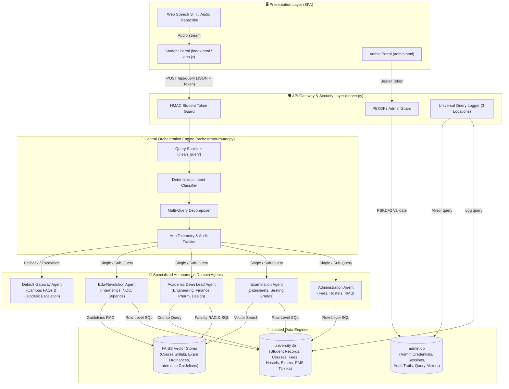
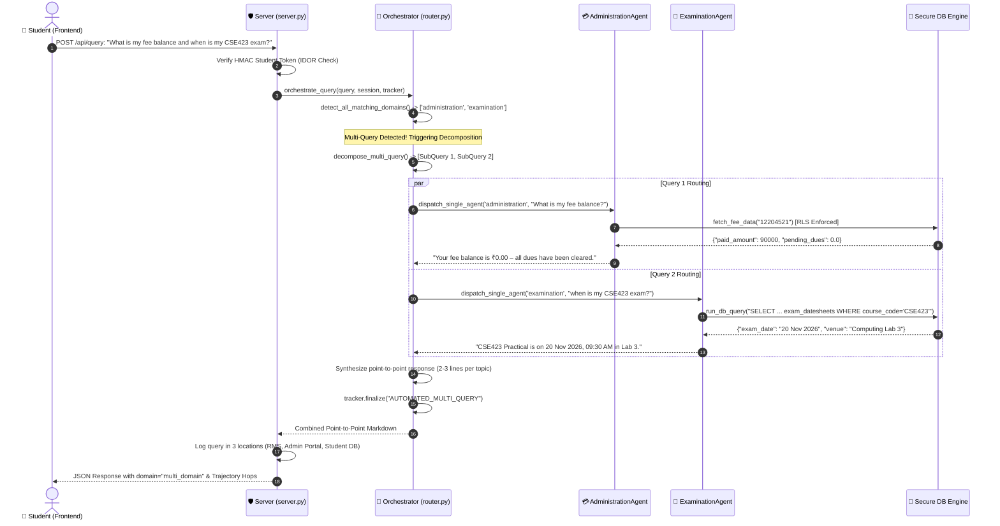
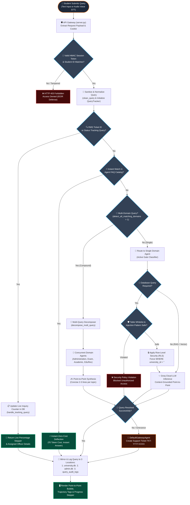
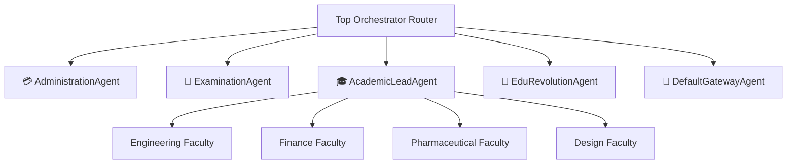

# 🎓 University Multi-Agent Support & RMS Orchestration System

[](#)
[](#)
[-003B57.svg?logo=sqlite&logoColor=white)](#)
[-F55036.svg)](#)
[](#)

A high-performance, enterprise-grade **Multi-Agent University Support Portal & Relationship Management System (RMS)**. The system dynamically classifies, decomposes, and orchestrates complex student inquiries across specialized autonomous domain agents with strict zero-trust data breach protections, dual-database isolation, and concise point-to-point responses.

---

## 📑 Table of Contents

- [System Architecture Overview](#-system-architecture-overview)
- [How a Query Travels (End-to-End Flow)](#-how-a-query-travels-end-to-end-flow)
  - [1. From the Frontend to the Backend](#1-from-the-frontend-to-the-backend)
  - [2. Inside the Backend Orchestration Layer](#2-inside-the-backend-orchestration-layer)
  - [3. Multi-Query Decomposition & Execution](#3-multi-query-decomposition--execution)
  - [4. Multi-Circumstance Decision Flowchart](#4-multi-circumstance-decision-flowchart)
  - [5. Database Engine & Row-Level Security Execution](#5-database-engine--row-level-security-execution)
  - [6. Returning & Rendering in the Frontend](#6-returning--rendering-in-the-frontend)
- [Query Handling Circumstances & Scenarios](#-query-handling-circumstances--scenarios)
- [Database Architecture & Isolation](#-database-architecture--isolation)
  - [University Database (`university.db`)](#1-university-database-universitydb)
  - [Administrator Database (`admin.db`)](#2-administrator-database-admindb)
  - [Data Breach Prevention & Row-Level Security (RLS)](#3-data-breach-prevention--row-level-security-rls)
- [Autonomous Domain Agents](#-autonomous-domain-agents)
- [Frontend Responsiveness & Cross-Device Usability](#-frontend-responsiveness--cross-device-usability)
  - [1. Responsive Breakpoint Architecture](#1-responsive-breakpoint-architecture)
  - [2. Component Adaptation Matrix](#2-component-adaptation-matrix)
  - [3. Accessibility Compliance (WCAG 2.1 AA)](#3-accessibility-compliance-wcag-21-aa)
  - [4. Cross-Device Testing & Verification Matrix](#4-cross-device-testing--verification-matrix)
- [API Reference](#-api-reference)
- [Setup & Execution Guide](#-setup--execution-guide)

---

## 🏛 System Architecture Overview

The system architecture cleanly decouples the presentation layer, the API Gateway, the orchestration engine, autonomous domain sub-agents, and two isolated database storage engines:



---

## 🔄 How a Query Travels (End-to-End Flow)

### 1. From the Frontend to the Backend
1. **User Input**:
   - The student types a query in the chat input or dictates it via microphone.
   - For audio, the frontend uses the Web Speech API or posts audio to `/api/transcribe` (transcribed via Groq Whisper API).
2. **Session Attachment**:
   - `static/app.js` retrieves the authenticated registration number from `sessionStorage` (`state.currentStudent.registration_no`).
   - The browser automatically attaches the `student_session_token` cookie issued during login.
3. **HTTP Dispatch**:
   - An asynchronous `fetch` sends an HTTP `POST` to `/api/query` with JSON:
     ```json
     {
       "query": "What is my current fee balance and when is my CSE423 exam?",
       "registration_no": "12204521",
       "student_name": "Aditya Sharma",
       "four_digit_number": "4521"
     }
     ```

### 2. Inside the Backend Orchestration Layer
1. **Cryptographic Token Verification & IDOR Defense**:
   - `server.py` passes the request through `get_authenticated_student_id(request)`.
   - The cryptographic HMAC signature is validated. If a student attempts to query or tamper with another student's registration ID (`reg_no != auth_uid`), the server aborts the request immediately with `HTTP 403 Forbidden`.
2. **Session & Tracker Initialization**:
   - `StudentSession` loads the authenticated profile (`Aditya Sharma`, `12204521`, Semester 6, CSE).
   - `QueryTracker` generates a unique audit trace identifier (e.g. `QRY-8A7B3C1D`) to track hop telemetry.
3. **Sanitization (`clean_query`)**:
   - The raw query is lowercased, punctuation and special symbols are removed, and whitespace is normalized.

### 3. Multi-Query Decomposition & Execution
When a student asks multiple questions in a single prompt (e.g., fee balance + exam schedule):



### 4. Multi-Circumstance Decision Flowchart

The following flowchart maps how any student query traverses the system under different circumstances, illustrating every decision diamond, security gate, routing branch, and fallback escalation path:



### 5. Database Engine & Row-Level Security Execution
- In `core/db_engine.py`, queries pass through `run_db_query(sql_query, authenticated_student_id)`.
- If student-private tables are touched (`grade_records`, `student_fees`, `hostel_allocations`, `internship_files`), the engine **strictly forces** `WHERE university_id = '<authenticated_student_id>'`.
- Attempting to query another student's ID or injecting non-whitelisted SQL syntax triggers an instant security policy rejection.

### 6. Returning & Rendering in the Frontend
1. **JSON Payload**:
   The backend returns:
   ```json
   {
     "success": true,
     "query": "What is my current fee balance and when is my CSE423 exam?",
     "response": "1. **Administration & Fees**: Your fee balance is ₹0.00 – all dues have been cleared.\n\n2. **Examination**: Your CSE423 Practical is on 20 Nov 2026, 09:30 AM in Lab 3.",
     "domain": "multi_domain",
     "total_hops": 2,
     "trajectory": ["AdministrationAgent", "ExaminationAgent"],
     "status": "resolved"
   }
   ```
2. **DOM Update (`static/app.js`)**:
   - Chat stream renders the point-to-point answer bubble.
   - Stepper timeline and trajectory pill tags (`AdministrationAgent ➔ ExaminationAgent`) render live.
   - Active RMS ticket badge and history counters automatically sync.

---

## 🎯 Query Handling Circumstances & Scenarios

| Circumstance / Scenario | Trigger Condition | Execution Path | Resolution Mechanism |
| :--- | :--- | :--- | :--- |
| **1. Instant Zero-Cost FAQ** | Standard inquiries (e.g. hostel curfew, fee payment modes, Wi-Fi setup, library hours). | Evaluated in domain agent via `match_faq()` catalog. | Deflected instantly without invoking LLM or SQL (₹0 token cost). |
| **2. Single-Domain Query** | Specific inquiry belonging to a single domain (e.g. "What is my hostel room allotment?"). | Directed via `active_gate_classify()` straight to matching domain agent. | Single-hop execution, live SQL lookup scoped to student ID, concise 2-3 line response. |
| **3. Multi-Query Compound Question** | Student asks 2 or more questions across different topics in one prompt. | `detect_all_matching_domains()` identifies multiple domains; `decompose_multi_query()` breaks down sub-queries. | Parallel/sequential routing across specialized agents; synthesized numbered point-to-point response. |
| **4. Live RMS Ticket Tracking** | Mentions ticket ID (e.g., `RMS2025004827`) or asks "Where is my ticket status?". | Intercepted deterministically by `detect_rms_intent()` ➔ `handle_tracking_query()`. | Updates inquiry counter & timestamp in DB; renders live percentage progress bar & stage officer details. |
| **5. IDOR / Data Breach Attempt** | Attacker tampers with request to inspect another student's tickets or grades. | `get_authenticated_student_id()` detects mismatch against session token; `run_db_query()` checks RLS. | Blocked immediately with `403 Forbidden` (`"Access Denied: Cross-student data access is strictly prohibited"`). |
| **6. SQL Injection / Tampering** | Query contains `;`, `--`, `/*`, `DROP`, `UPDATE`, or accesses `admin.db`. | Validated against `DISALLOWED_PATTERNS` and `ALL_ALLOWED_TABLES` whitelist. | Rejected instantly: `"Security Violation: Disallowed SQL token or unauthorized table"`. |
| **7. Human Helpdesk Escalation** | Complex grievance or unresolvable campus request unhandled by AI agents. | Routed to `DefaultGatewayAgent.run()`. | Generates support ticket `TKT-YYYY-XXXX`, stores grievance in `helpdesk_tickets`, returns diagnostic audit trace. |

---

## 💾 Database Architecture & Isolation

The system enforces physical database isolation between student operational records and administrative authentication credentials:

```mermaid
graph LR
    subgraph UNIV ["📁 university.db (Operational Storage)"]
        direction TB
        T1["students"]
        T2["student_fees"]
        T3["hostel_allocations"]
        T4["courses"]
        T5["exam_datesheets"]
        T6["seating_arrangements"]
        T7["grade_records"]
        T8["internship_files"]
        T9["helpdesk_tickets (RMS)"]
        T10["query_audit_logs & query_hops"]
        T11["student_queries"]
    end

    subgraph ADMIN ["📁 admin.db (Administrative Storage)"]
        direction TB
        A1["admin_users (PBKDF2 Hashes)"]
        A2["admin_sessions (Session Tokens)"]
        A3["admin_query_records (Audit Mirror)"]
        A4["admin_audit_logs (Officer Actions)"]
    end

    UNIV -.->|"Strict Physical Separation\nNo Cross-Database Joins"| ADMIN
```



### 1. University Database (`university.db`)
- **`students`**: Stores student identity, university ID, registration number, departmental affiliation, current semester, and assigned faculty mentor.
- **`student_fees`**: Total term fee, paid amounts, pending dues, due dates, payment status, and scholarship waivers.
- **`hostel_allocations`**: Assigned hostel block, room number, room occupancy type, and chief warden contact details.
- **`courses`**: Course codes, course names, credit values, instructor names, weekly lecture schedules, and classroom numbers.
- **`exam_datesheets`**: Examination timetables, session timings, and examination centers.
- **`seating_arrangements`**: Individual desk allocations, examination hall numbers, and invigilator names.
- **`grade_records`**: Historical course grades, semester credits, and performance records.
- **`internship_files`**: Corporate internship profiles, HOD/Dean sign-offs, stipend details, and NOC issuance states.
- **`helpdesk_tickets`**: RMS support tickets, current stage progress (1 to 4), assigned officers, estimated resolution time, and live inquiry counters.
- **`query_audit_logs` & `query_hops`**: Comprehensive audit trails capturing raw queries, resolution types, total hops, and full routing trajectories.

### 2. Administrator Database (`admin.db`)
- **`admin_users`**: Administrative credentials secured with **PBKDF2-HMAC-SHA256** (100,000 rounds) and random 16-byte cryptographic salts.
- **`admin_sessions`**: Active administrative bearer tokens, IP address records, and expiration timestamps (12-hour expiry).
- **`admin_query_records`**: Synchronized mirror of all incoming student queries for monitoring and resolution oversight.
- **`admin_audit_logs`**: Immutable audit logs of administrative actions (e.g. ticket stage updates, resolution notes, status overrides).

### 3. Data Breach Prevention & Row-Level Security (RLS)
> [!IMPORTANT]
> **Zero-Trust Student Isolation**:
> 1. Students can **never** query or observe records belonging to other students.
> 2. `core/db_engine.py` automatically injects `WHERE university_id = '<authenticated_student_id>'` onto any query referencing student tables.
> 3. Any query referencing another student's ID produces an immediate `Security Policy Violation`.
> 4. All admin tables (`admin_users`, `admin_sessions`) are inaccessible to student tools.

---

## 🤖 Autonomous Domain Agents



### 1. Administration Agent ([domains/administration/agent.py](file:///Users/aditya/Documents/INT_335_Project/domains/administration/agent.py))
- **Responsibilities**: Tuition fee inquiries, installment policies, scholarship retention rules, hostel gate pass timings, and live RMS grievance tracking.
- **Tools**: Direct parameterized SQL (`fetch_fee_data`) and instant zero-cost FAQ matcher.

### 2. Examination Agent ([domains/examination/agent.py](file:///Users/aditya/Documents/INT_335_Project/domains/examination/agent.py))
- **Responsibilities**: Datesheets, examination seat and desk allocations, admit cards, backlog/re-appear policies, and grade transcripts.
- **Tools**: `query_examination_database` (with row-level student isolation) and `search_exam_ordinances` (FAISS vector search).

### 3. Chief Academic Dean Agent ([domains/academic/academic_lead.py](file:///Users/aditya/Documents/INT_335_Project/domains/academic/academic_lead.py))
- **Responsibilities**: Manages academic faculties, course outlines, lab timings, and faculty mentorship consultations.
- **Sub-Agents**:
  - `consult_engineering_faculty`
  - `consult_finance_faculty`
  - `consult_pharmaceutical_faculty`
  - `consult_design_faculty`
- **Tools**: Department syllabus vector search (`search_department_syllabus`) and live course schedule database lookups.

### 4. Edu-Revolution & Career Services Agent ([domains/edu_revolution/agent.py](file:///Users/aditya/Documents/INT_335_Project/domains/edu_revolution/agent.py))
- **Responsibilities**: Industrial internships, corporate training, weekly report submissions, HOD/Dean approvals, and official digital NOC generation.
- **Tools**: `query_internship_files` (scoped to student ID) and `search_internship_guidelines` (FAISS search).

### 5. Default Campus Gateway Agent ([domains/default_gateway/agent.py](file:///Users/aditya/Documents/INT_335_Project/domains/default_gateway/agent.py))
- **Responsibilities**: General campus facilities (Central Library, 24/7 Uni-Hospital, Wi-Fi IT Desk) and fallback escalation to human officers.
- **Tools**: Gateway FAQ matcher and human helpdesk ticket generator.

---

## 📱 Frontend Responsiveness & Cross-Device Usability

The user interface is engineered with a **mobile-first, device-agnostic responsive design system** complying with **WCAG 2.1 AA** standards across smartphones, tablets, laptops, and ultra-wide desktop monitors.

### 1. Responsive Breakpoint Architecture

| Target Form Factor | Viewport Range | Layout Configuration | Key Component Behaviors |
| :--- | :--- | :--- | :--- |
| **Ultra-Compact Mobile** | `< 360px` | Single-column fluid stack | 14px base font, compact dock buttons, fluid headers (`clamp(1.45rem, 5vw, 1.8rem)`). |
| **Mobile Smartphones** | `360px – 767px` | 100dvh full viewport | Slide-out drawer sidebar with glass backdrop, swipeable view switcher, 1-col suggestions. |
| **Tablets & Small Laptops** | `768px – 1024px` | Adaptive split / collapsible | 2-column suggestions, compact top navigation, scrollable stepper. |
| **Desktop & Large Displays** | `> 1024px` | Multi-panel grid | Persistent sidebar (collapsible with `Cmd+B`), 3-column suggestion grid, full stepper timeline. |

### 2. Component Adaptation Matrix

- **Collapsible Drawer Sidebar**:
  - *Desktop*: Smooth margin-collapse with persistent navigation icons and `Cmd+B` keyboard shortcut toggle.
  - *Mobile/Tablet*: Transforms into an off-canvas slide-out drawer (`position: fixed; width: min(320px, 86vw)`) with a dark frosted glass overlay (`backdrop-filter: blur(8px); z-index: 45`).
- **Segmented View Switcher**:
  - Adapts to a horizontally swipeable, momentum-scrolling pill bar with hidden scrollbars on mobile (`-webkit-overflow-scrolling: touch; scrollbar-width: none`).
- **Interactive RMS Stepper**:
  - Horizontal scroll container on mobile viewports ensuring nodes and connectors never wrap, compress, or distort.
- **Data & History Tables**:
  - Wrapped in fluid horizontal containers (`overflow-x: auto; -webkit-overflow-scrolling: touch`) with minimum column widths preventing text truncation.
- **Bottom Interaction Dock**:
  - Fixed above soft keyboards using dynamic viewport units (`100dvh`). Touch buttons meet the minimum **44×44px** hit target. Input font size is fixed at `16px` on mobile to prevent unwanted iOS Safari auto-zooming.

### 3. Accessibility Compliance (WCAG 2.1 AA)

- **Touch Targets**: Minimum **44×44px** touch target area enforced on all interactive buttons, pills, chips, and navigation items via `@media (pointer: coarse)`.
- **Keyboard Navigation & Focus Indicators**: All interactive elements feature high-visibility `:focus-visible` focus rings (`outline: 2px solid #df6d4d; outline-offset: 2px`).
- **Screen Reader Support**: Semantic HTML5 elements (`<aside>`, `<header>`, `<main>`, `<nav>`, `<button>`) paired with descriptive `aria-label`, `aria-expanded`, and `role` attributes.
- **Contrast Ratios**: Body text meets a minimum contrast ratio of 4.5:1 against dark surface backgrounds; high-contrast warning and badge colors exceed 7:1.

### 4. Cross-Device Testing & Verification Matrix

| Device / Platform | Tested Resolution | Verification Criteria | Status |
| :--- | :--- | :--- | :--- |
| **iPhone 13 / 14 / 15 (Safari)** | `390 × 844` | No input auto-zoom on focus; drawer opens/closes via touch overlay; bottom dock respects safe area. | ✅ Verified |
| **Samsung Galaxy S22 / S23 (Chrome)** | `360 × 800` | Dynamic viewport height adjusts for address bar; suggestion cards stack cleanly in 1 column. | ✅ Verified |
| **iPad Air / Pro (Safari)** | `820 × 1180` / `1024 × 1366` | 2-column card grid renders cleanly; sidebar toggle operates smoothly; table layouts display full telemetry. | ✅ Verified |
| **MacBook / Windows (Chrome/Edge/Firefox)** | `1440 × 900` / `1920 × 1080` | Full 3-column layout; persistent sidebar; `Cmd+B` shortcut toggles navigation; full stepper renders inline. | ✅ Verified |

---

## 🔌 API Reference

### Student Endpoints

| Method | Endpoint | Description | Auth Required |
| :--- | :--- | :--- | :--- |
| `POST` | `/api/login` | Authenticates student by registration number; sets HMAC session cookie. | No |
| `POST` | `/api/query` | Primary chat execution endpoint; routes single or multi-domain queries. | Yes (Token / Reg No) |
| `GET` | `/api/session` | Fetches active authenticated student academic profile. | Yes (Token) |
| `GET` | `/api/tickets` | Returns student's RMS tickets and resolution metrics (IDOR protected). | Yes (Token) |
| `GET` | `/api/history` | Returns query conversation history and audit hops. | Yes (Token) |
| `POST` | `/api/transcribe` | Transcribes student audio file using Groq Whisper. | Yes (Token) |

### Administrator Endpoints (Isolated `admin.db`)

| Method | Endpoint | Description | Auth Required |
| :--- | :--- | :--- | :--- |
| `POST` | `/api/admin/login` | Authenticates administrator against PBKDF2 hash in `admin.db`. | No |
| `GET` | `/api/admin/session` | Validates active admin session token. | Yes (Admin Token) |
| `POST` | `/api/admin/logout` | Terminates active administrator session. | Yes (Admin Token) |
| `GET` | `/api/admin/tickets` | Lists all student helpdesk tickets across the university. | Yes (Admin Token) |
| `POST` | `/api/admin/ticket/update`| Updates ticket stage progress (1-4), assigned officer, or status. | Yes (Admin Token) |
| `GET` | `/api/admin/audit-logs` | Fetches immutable administrative audit trail. | Yes (Admin Token) |
| `GET` | `/api/admin/student-queries` | Returns mirrored student query audit logs. | Yes (Admin Token) |

---

## 🚀 Setup & Execution Guide

### 1. Prerequisites
- Python 3.10 or higher
- Valid Groq Cloud API Key (`GROQ_API_KEY`)

### 2. Environment Configuration
Create or verify `.env` in the project root:
```env
GROQ_API_KEY="gsk_your_groq_api_key_here"
STUDENT_TOKEN_SECRET="university_student_token_secret_key_2026"
```

### 3. Install Dependencies
```bash
pip install -r requirements.txt
```

### 4. Initialize Databases
Initialize both operational and administrative databases:
```bash
python database_setup.py
python -c "from core.admin_db import init_admin_database; init_admin_database()"
```

### 5. Launch the Web Application
```bash
python server.py
```
The server will start at:
- **Student Portal**: [http://localhost:8000](http://localhost:8000)
- **Administrator Management Portal**: [http://localhost:8000/admin](http://localhost:8000/admin)

### 6. Interactive CLI Testing
To test the multi-agent orchestration directly in the terminal:
```bash
python main.py
```
To inspect administrative tickets via CLI:
```bash
python admin_cli.py --list
```
